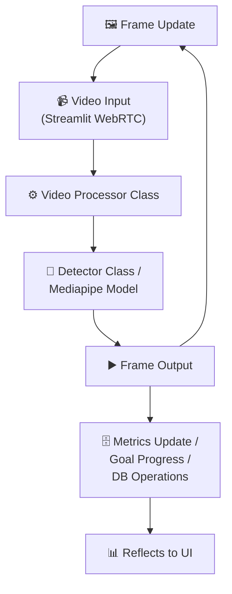

# 🏋️‍♂️ Vision-Based Workout System (AI Gym Trainer)

[](https://www.python.org/)
[](https://streamlit.io/)
[](https://developers.google.com/mediapipe)
[](https://opencv.org/)
[](LICENSE)

An intelligent, real-time computer vision fitness trainer that monitors exercise form, tracks repetitions, calculates joint biomechanics, and delivers audio & visual feedback directly through an interactive WebRTC Streamlit interface.


## 🏋️ Supported Exercises & Tracked Metrics

| Exercise | Tracked Biometrics | Form Quality Checks |
| :--- | :--- | :--- |
| **Squats** | Knee Angle, Back Angle | Depth Status (Parallel / Full / Shallow) |
| **Push-ups** | Elbow Angle, Body Alignment | Hip Sagging / Elevation Status |
| **Bicep Curls** | Elbow Angle | Shoulder Stability & Body Swing Detection |
| **Shoulder Press** | Elbow Angle, Arm Extension | Back Arching & Lockout Validation |
| **Lunges** | Front Knee Angle, Torso Angle | Balance & Knee Over Extension |

---

## 🏗️ Project Architecture

```plaintext
Ai-GYM_Trainer/
├── core/                       # Core kinematics and calculation engines
├── detectors/                  # Exercise-specific landmark detectors
├── ml_models/                  # Trained models and pose classification weights
├── services/                   # Modular service architecture
│   ├── auth/                   # Authentication & login wall UI
│   ├── coaching/               # LLM feedback & audio cue services
│   ├── config/                 # Workout & exercise configuration schemas
│   ├── persistence/            # Session persistence & history logging
│   ├── state/                  # Streamlit session state management
│   ├── tracking/               # Repetition counter & set trackers
│   ├── ui/                     # Custom CSS & font injectors
│   └── vision/                 # WebRTC frame processors & MediaPipe pipelines
├── static/                     # Custom fonts (AdobeClean.otf) & stylesheet (style.css)
├── .env.example                # Template for environment credentials
├── .gitignore                  # Git ignore rules for virtualenvs and secrets
├── main.py                     # Streamlit application entry point
└── requirements.txt            # Project dependencies
```

### 🎥 1. Video Feature – Complete Workflow

The diagram below illustrates the end-to-end real-time video processing pipeline: from live webcam streaming via Streamlit WebRTC through MediaPipe pose estimation, metric calculation, SQLite database persistence, and UI updates.




#### Workflow Breakdown:
1. **Video Ingestion Loop (`Streamlit WebRTC`)**:
   - The user's live webcam stream is captured in real time via `streamlit-webrtc` (`Video Input`).
   - Frames are continuously passed to the custom `Video Processor Class`.
2. **Pose Detection & Kinematics (`MediaPipe & OpenCV`)**:
   - The `Detector Class` passes RGB frames to the Google MediaPipe Pose model to extract 33 3D body landmarks.
   - Computes biomechanical joint angles (e.g., knee, elbow, torso, back arch) and evaluates exercise posture.
3. **Frame Output & Feedback Loop**:
   - Real-time skeletons, angles, and feedback overlays are drawn directly onto the video frame (`Frame Output`).
   - The annotated frame is pushed to `Frame Update` for smooth WebRTC display in the browser.
4. **Metrics Update & Database Operations (`SQLite`)**:
   - Analyzes motion states to count repetitions and validate sets completed.
   - Evaluates progress against user-configured workout goals.
   - Saves session statistics and history into the local SQLite database.
5. **Reflects to UI**:
   - Updates live dashboard metrics, scorecards, repetition counters, and posture status in the Streamlit frontend.

---

## 🚀 Getting Started

### 1. Prerequisites
- **Python 3.10+**
- A working **Webcam**
- (Optional) [uv](https://github.com/astral-sh/uv) for fast package management

### 2. Clone the Repository
```bash
git clone https://github.com/thatvivekhingu/Vision-Based-Workout-System.git
cd Vision-Based-Workout-System
```

### 3. Create & Activate Virtual Environment

**Using `uv` (Recommended):**
```bash
# Create venv
uv venv

# Activate venv
# On Windows (PowerShell):
.venv\Scripts\activate
# On Linux / macOS:
source .venv/bin/activate
```

**Using standard `python -m venv`:**
```bash
python -m venv .venv
.venv\Scripts\activate   # Windows PowerShell
```

### 4. Install Dependencies
```bash
# Using uv
uv pip install -r requirements.txt

# Or using standard pip
pip install -r requirements.txt
```

### 5. Setup Environment Variables
Create a `.env` file in the project root:
```env
GROQ_API_KEY=your_groq_api_key_here
```

### 6. Run the Application
```bash
streamlit run main.py
```
Open your browser and navigate to `http://localhost:8501`.

---

## 💻 Tech Stack

- **Frontend & App Framework:** [Streamlit](https://streamlit.io/), [streamlit-webrtc](https://github.com/whitphx/streamlit-webrtc)
- **Computer Vision & ML:** [MediaPipe](https://developers.google.com/mediapipe), [OpenCV](https://opencv.org/)
- **Audio Feedback:** [gTTS](https://pypi.org/project/gTTS/)
- **LLM Coaching:** [Groq](https://groq.com/)
- **Styling:** Custom CSS, CSS Grid/Flexbox, Adobe Clean font

---

## 🤝 Contributing

Contributions are welcome! Please follow these steps:
1. Fork the Project
2. Create your Feature Branch (`git checkout -b feature/AmazingFeature`)
3. Commit your Changes (`git commit -m 'Add some AmazingFeature'`)
4. Push to the Branch (`git push origin feature/AmazingFeature`)
5. Open a Pull Request

---

## 📄 License

Distributed under the MIT License. See `LICENSE` for more information.
