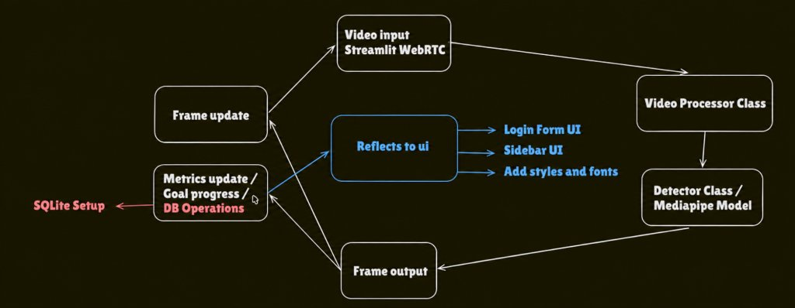
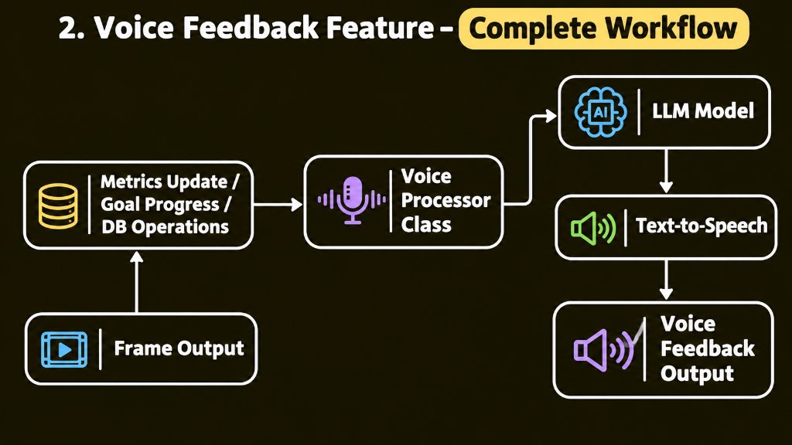

# 🏋️‍♂️ Vision-Based Workout System (AI Real-Time Gym Coach)

[](https://www.python.org/)
[](https://streamlit.io/)
[](https://developers.google.com/mediapipe)
[](https://opencv.org/)
[](LICENSE)

An intelligent, real-time computer vision fitness trainer that monitors exercise form, tracks repetitions, calculates joint biomechanics, and delivers audio & visual feedback directly through an interactive WebRTC Streamlit interface.

---

## 💻 Tech Stack

- **Python** (main language)
- **Streamlit** (UI)
- **WebRTC** (camera streaming)
- **MediaPipe** (pose detection)
- **OpenCV** (image processing)
- **SQLite** (database)
- **gTTS** (voice)
- **LLM API** (for coaching intelligence)


## 🏋️ Supported Exercises & Tracked Metrics

| Exercise | Tracked Biometrics | Form Quality Checks |
| :--- | :--- | :--- |
| **Squats** | Knee Angle, Back Angle | Depth Status (Parallel / Full / Shallow) |
| **Push-ups** | Elbow Angle, Body Alignment | Hip Sagging / Elevation Status |
| **Bicep Curls** | Elbow Angle | Shoulder Stability & Body Swing Detection |
| **Shoulder Press** | Elbow Angle, Arm Extension | Back Arching & Lockout Validation |
| **Lunges** | Front Knee Angle, Torso Angle | Balance & Knee Over Extension |

### 🎥 1. Video Feature – Complete Workflow

The diagram below illustrates the end-to-end real-time video processing pipeline: from live webcam streaming via Streamlit WebRTC through MediaPipe pose estimation, metric calculation, SQLite database persistence, and UI updates.



#### Workflow Breakdown:
1. **Video Ingestion Loop (`Streamlit WebRTC`)**:
   - The user's live webcam stream is captured in real time via `streamlit-webrtc` (`Video Input`).
   - Frames are continuously passed to the custom `Video Processor Class`.
2. **Pose Detection & Kinematics (`MediaPipe & OpenCV`)**:
   - The `Detector Class` passes RGB frames to the Google MediaPipe Pose model to extract 33 3D body landmarks.
   - Computes biomechanical joint angles (e.g., knee, elbow, torso, back arch) and evaluates exercise posture.
3. **Frame Output & Feedback Loop**:
   - Real-time skeletons, angles, and feedback overlays are drawn directly onto the video frame (`Frame Output`).
   - The annotated frame is pushed to `Frame Update` for smooth WebRTC display in the browser.
4. **Metrics Update & Database Operations (`SQLite`)**:
   - Analyzes motion states to count repetitions and validate sets completed.
   - Evaluates progress against user-configured workout goals.
   - Saves session statistics and history into the local SQLite database.
5. **Reflects to UI**:
   - Updates live dashboard metrics, scorecards, repetition counters, and posture status in the Streamlit frontend.

---

### 🎙️ 2. Voice Feedback Feature – Complete Workflow

The diagram below illustrates how workout metrics and posture evaluations trigger real-time AI audio coaching: from kinematic metric detection through LLM reasoning and text-to-speech synthesis.




#### Workflow Breakdown:
1. **Kinematic Trigger (`Frame Output` ➔ `Metrics`)**:
   - Landmark detections from the video pipeline evaluate joint angles, repetition transitions, and form issues (e.g., knee caving, shallow squat, excessive back arch).
2. **Context Aggregation (`Metrics Update / Goal Progress`)**:
   - The system tracks exercise milestones (e.g., "5 reps completed", "Set 2 finished") or detects repeated posture errors requiring guidance.
3. **Voice Processor Class**:
   - Debounces notifications to prevent audio spam and constructs concise situational context (exercise, set, reps, specific posture fault).
4. **AI Coaching Intelligence (`LLM Model - Groq`)**:
   - High-speed inference using Groq generates quick, motivational, and biomechanically accurate coaching prompts (e.g., *"Keep your chest proud and drive through your heels!"*).
5. **Audio Synthesis (`Text-to-Speech - gTTS`)**:
   - Converts the AI coaching text into speech audio streams on the fly.
6. **Voice Feedback Output**:
   - Delivers hands-free auditory feedback directly to the lifter in real time, keeping workouts seamless and safe.

---
## 💡 Why This Project Matters

- **Computer Vision** (body tracking)
- **Rule-based AI** (exercise detection)
- **Real-time processing**
- **Voice generation**
- **LLM-based coaching**

---

## ✨ Features Breakdown

- **Real-time pose detection**
- **Squat, push-up, curl tracking**
- **Rep counting system**
- **Form correction logic**
- **User login + history tracking**
- **AI-generated coaching feedback**
- **Voice output** (like a real trainer)

---
## 🚀 Getting Started

### 1. Prerequisites
- **Python 3.10+**
- A working **Webcam**
- (Optional) [uv](https://github.com/astral-sh/uv) for fast package management

### 2. Clone the Repository
```bash
git clone https://github.com/thatvivekhingu/Vision-Based-Workout-System.git
cd Vision-Based-Workout-System
```

### 3. Create & Activate Virtual Environment

**Using `uv` (Recommended):**
```bash
# Create venv
uv venv

# Activate venv
# On Windows (PowerShell):
.venv\Scripts\activate
# On Linux / macOS:
source .venv/bin/activate
```

**Using standard `python -m venv`:**
```bash
python -m venv .venv
.venv\Scripts\activate   # Windows PowerShell
```

### 4. Install Dependencies
```bash
# Using uv
uv pip install -r requirements.txt

# Or using standard pip
pip install -r requirements.txt
```

### 5. Setup Environment Variables
Create a `.env` file in the project root:
```env
GROQ_API_KEY=your_groq_api_key_here
```

### 6. Run the Application
```bash
streamlit run main.py
```
Open your browser and navigate to `http://localhost:8501`.

---


---

## 🤝 Contributing

Contributions are welcome! Please follow these steps:
1. Fork the Project
2. Create your Feature Branch (`git checkout -b feature/AmazingFeature`)
3. Commit your Changes (`git commit -m 'Add some AmazingFeature'`)
4. Push to the Branch (`git push origin feature/AmazingFeature`)
5. Open a Pull Request

---

## 📄 License

Distributed under the MIT License. See `LICENSE` for more information.
